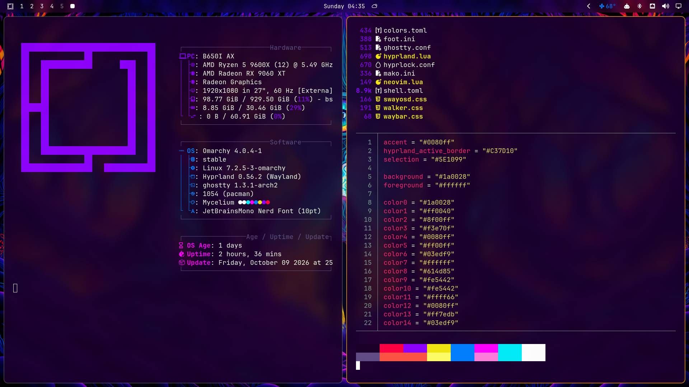
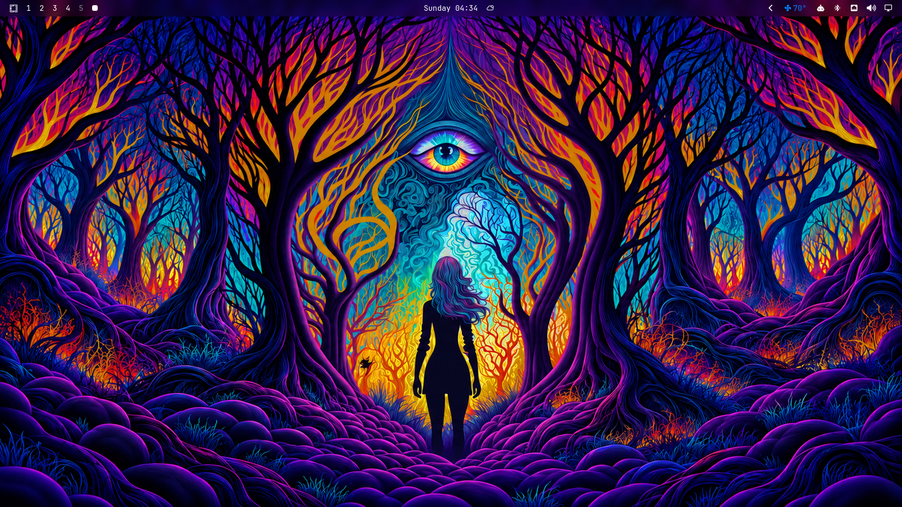

# Mycelium

A deep-violet [Omarchy](https://omarchy.org) theme built around a glowing psychedelic forest: indigo trunks, ember-amber window borders, and a cyan third eye watching over it all.





## Install

```bash
omarchy theme install https://github.com/Angelo-Tassi/omarchy-mycelium-theme
```

Or open the Omarchy menu (`Super + Alt + Space`) → **Install → Style → Theme** and paste the repo URL.

## Palette

| Role | Color |
|---|---|
| Background | `#1a0028` |
| Foreground | `#ffffff` |
| Active border | `#C37D10` |
| Selection | `#5E1099` |
| Accent | `#0080ff` |

## Optional: the full glass look

The screenshots use a few extras that Omarchy doesn't allow themes installed from git to ship, because they're Lua or terminal configs. To get them, add these to your own config.

**Rounded corners and frosted blur.** Add to `~/.config/hypr/looknfeel.lua`:

```lua
hl.config({
  decoration = {
    rounding = 10,
    blur = { enabled = true, size = 6, passes = 2, vibrancy = 0.2 },
  },
})

-- Frosted bar
hl.layer_rule({ match = { namespace = "omarchy-bar" }, blur = true, ignore_alpha = 0.1 })
```

**See-through terminals.** Add `background-opacity = 0.9` to `~/.config/ghostty/config`, or `alpha=0.9` under `[colors-dark]` in `~/.config/foot/foot.ini`.

The bar's frosted tint (`background-alpha = 0.15`) is already part of the theme's `shell.toml`. It looks best with the bar's transparent mode turned off.

## Credits

Colors are adapted from the [Synthwave '84 Omarchy theme](https://github.com/omacom-io/omarchy-synthwave84-theme).

Wallpaper: original artwork by Angelo Tassi, made in Midjourney (2022), then upscaled and extended.
