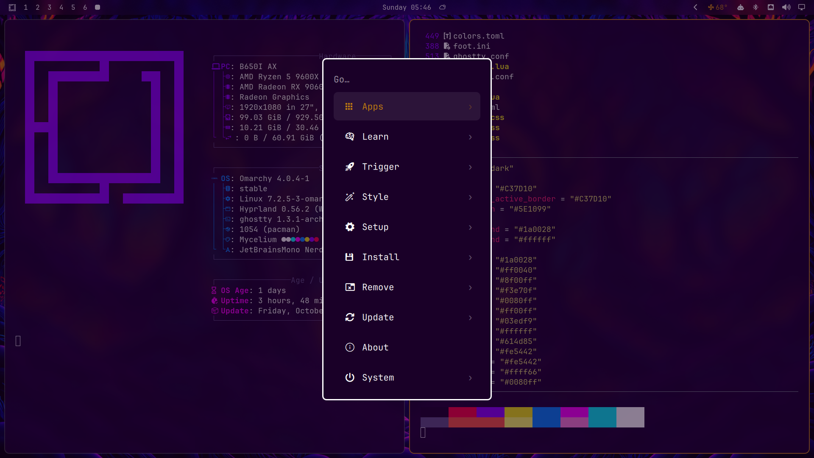
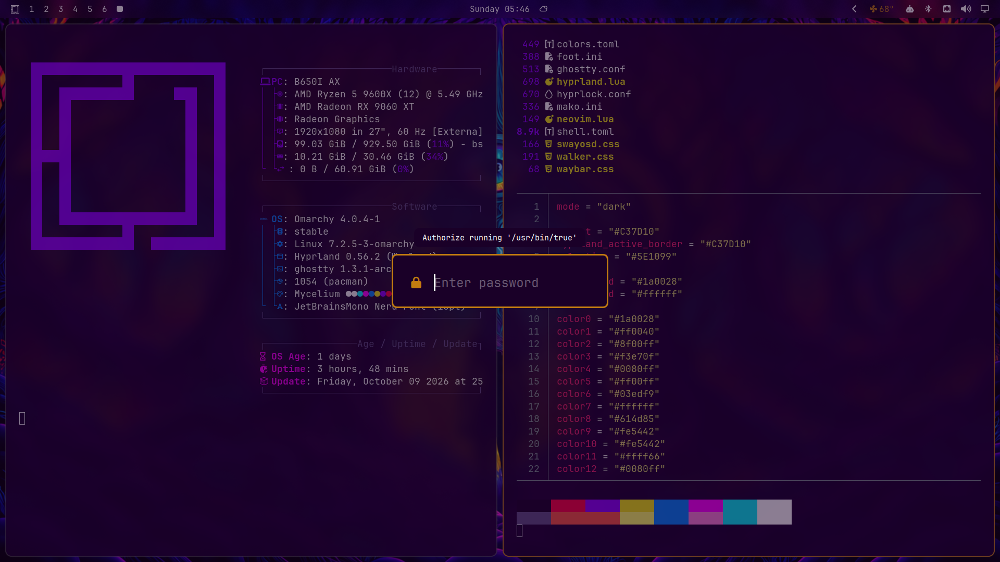

# Mycelium

A deep-violet [Omarchy](https://omarchy.org) theme built around a glowing psychedelic forest: indigo trunks, ember-amber window borders, and a cyan third eye watching over it all.


| Omarchy menu | Password prompt |
|---|---|
|  |  |

## Install

### Full install (recommended)

This gives you everything in the screenshots: rounded corners, frosted blur, the glass bar and see-through Ghostty/foot terminals.

```bash
git clone --depth 1 https://github.com/Angelo-Tassi/omarchy-mycelium-theme ~/.config/omarchy/themes/mycelium \
  && rm -rf ~/.config/omarchy/themes/mycelium/.git \
  && omarchy theme set mycelium
```

Removing `.git` turns it into a local theme. Omarchy loads a local theme's `hyprland.lua` and terminal configs, but strips them from themes installed from git because they can run code, so read `hyprland.lua`, `ghostty.conf` and `foot.ini` before installing. They only set colors, rounding, blur and opacity.

To update later, remove `~/.config/omarchy/themes/mycelium` and run the command again.

### Standard install

```bash
omarchy theme install https://github.com/Angelo-Tassi/omarchy-mycelium-theme
```

Or open the Omarchy menu (`Super + Alt + Space`) → **Install → Style → Theme** and paste the repo URL. You get the palette, the wallpaper, the amber borders and the bar tint, but not the rounding, blur or see-through terminals.

### Glass bar

For the frosted bar, turn off the bar's fully transparent mode: set `"transparent": false` under `bar` in `~/.config/omarchy/shell.json`.

## Palette

| Role | Color |
|---|---|
| Background | `#1a0028` |
| Foreground | `#ffffff` |
| Active border | `#C37D10` |
| Selection | `#5E1099` |
| Accent | `#C37D10` |

## Credits

Colors are adapted from the [Synthwave '84 Omarchy theme](https://github.com/omacom-io/omarchy-synthwave84-theme).

Wallpaper: original artwork by Angelo Tassi, made in Midjourney (2022), then upscaled and extended.
