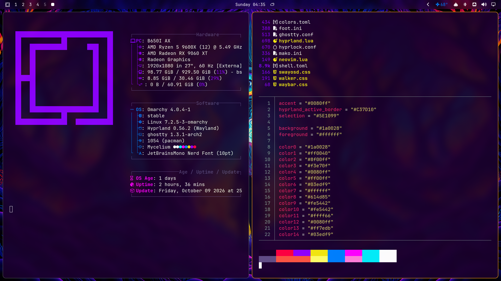
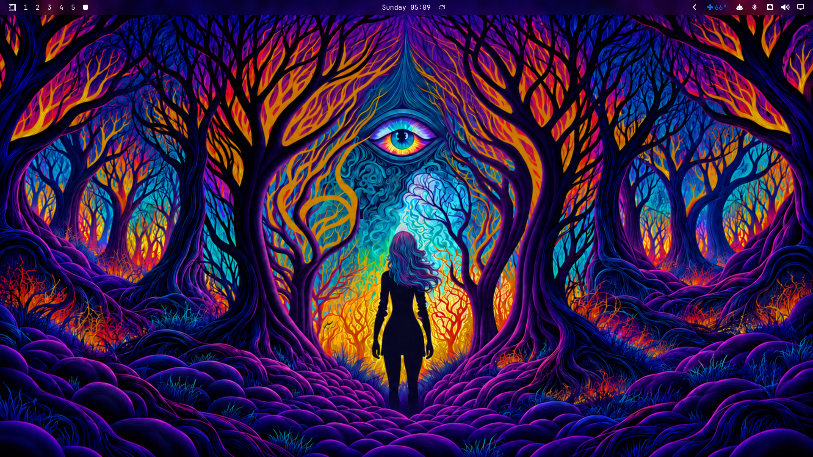
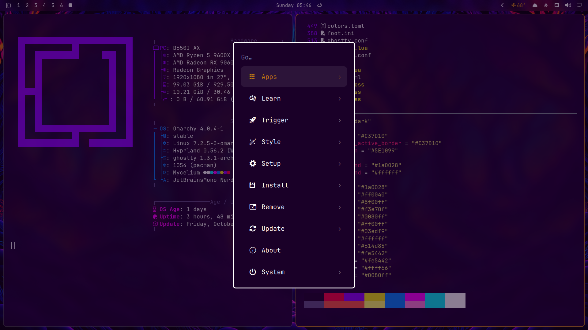
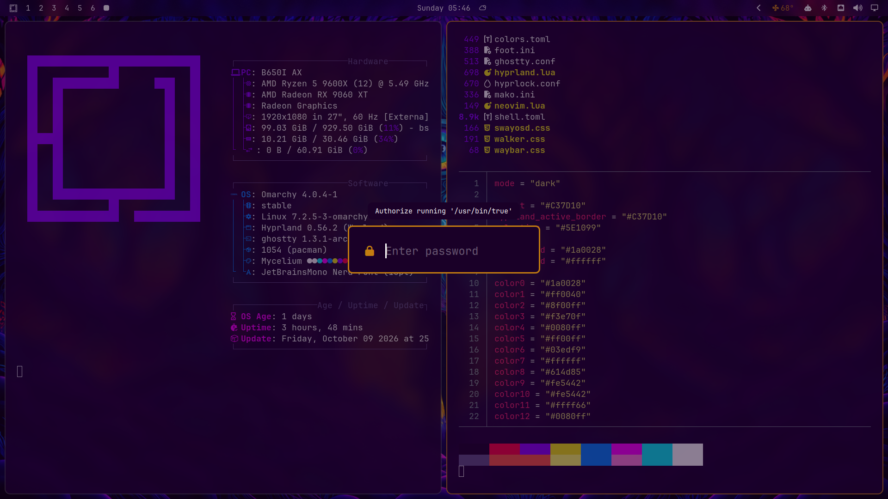

# Mycelium

A deep-violet [Omarchy](https://omarchy.org) theme built around a glowing psychedelic forest: indigo trunks, ember-amber window borders, and a cyan third eye watching over it all.





| Omarchy menu | Password prompt |
|---|---|
|  |  |

## Install

```bash
omarchy theme install https://github.com/Angelo-Tassi/omarchy-mycelium-theme
```

Or open the Omarchy menu (`Super + Alt + Space`) → **Install → Style → Theme** and paste the repo URL. You get the palette, the wallpaper, the amber borders and the bar tint. The rounded corners, blur and see-through terminals in the screenshots come from personal settings and are not part of the theme.

### Tinted bar

To show the bar tint, turn off the bar's fully transparent mode: set `"transparent": false` under `bar` in `~/.config/omarchy/shell.json`.

## Palette

| Role | Color |
|---|---|
| Background | `#1a0028` |
| Foreground | `#ffffff` |
| Active border | `#C37D10` |
| Selection | `#5E1099` |
| Accent | `#C37D10` |

## Credits

Colors are adapted from the [Synthwave '84 Omarchy theme](https://github.com/omacom-io/omarchy-synthwave84-theme).

Wallpaper: original artwork by Angelo Tassi, made in Midjourney (2022), then upscaled and extended.
